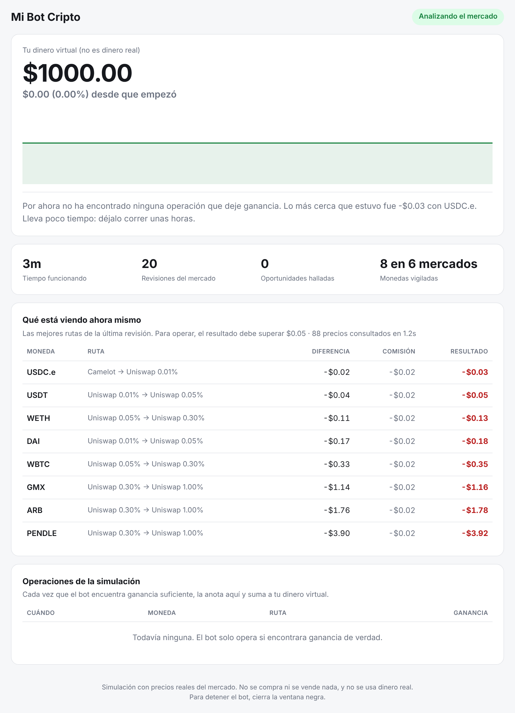

# Bot de arbitraje en Arbitrum

Escáner que busca diferencias de precio aprovechables entre mercados descentralizados (DEX) de la red
Arbitrum, calcula la rentabilidad real de cada operación descontando el costo de gas y muestra los
resultados en un panel web en tiempo real.

Funciona en **modo simulación**: solo lee precios de la cadena y registra lo que habría pasado.
No firma transacciones ni mueve fondos.



## Qué hace

En cada ciclo, para cada moneda vigilada:

1. Consulta en **6 mercados** cuántas unidades de la moneda se obtienen con el monto configurado de USDC.
2. Toma el mercado que más entrega y pregunta a los **otros cinco** cuántos USDC devuelven al revenderla.
3. Calcula la ganancia bruta del viaje de ida y vuelta.
4. Resta el costo de gas estimado, convertido a dólares con el precio de ETH del momento.
5. Si la ganancia neta supera el umbral configurado, la registra como oportunidad.

Mercados consultados: Uniswap V3 (comisiones 0.01 %, 0.05 %, 0.30 % y 1.00 %), SushiSwap y Camelot.

## Resultado

**No encontró ninguna oportunidad rentable.** La mejor ruta observada dejaba **−0,03 USD** sobre
100 USD: la diferencia de precio existe, pero no alcanza a cubrir el gas de las dos operaciones.

Es el resultado esperado. El arbitraje entre pares líquidos de DEX grandes está dominado por
operadores que compiten por el orden de ejecución dentro del bloque. El valor de este proyecto no es
la ganancia, sino haber medido la hipótesis con datos reales antes de arriesgar capital.

## Cómo funciona

### Consultas por lotes

Un escaneo ingenuo necesita una petición RPC por cada precio. Con 8 monedas y 6 mercados, un ciclo
completo son 88 cotizaciones; hacerlas una por una tarda varios segundos y agota los límites del
proveedor.

Este proyecto las agrupa con [Multicall3](https://github.com/mds1/multicall): las cotizaciones se
codifican como llamadas y se envían en bloques de 70 dentro de una sola petición `eth_call`.

**Resultado: 88 cotizaciones en ~1,2 segundos, en 2 peticiones de red en lugar de 88.**

No todos los nodos aceptan lotes del mismo tamaño: los RPC públicos rechazan los grandes. Cuando una
petición es rechazada, el motor parte el lote en dos, reintenta y recuerda el tamaño menor para los
ciclos siguientes. Así el proyecto funciona tanto con un nodo propio como con el RPC público, sin
configuración.

### Verificación previa de liquidez

Las direcciones de tokens y los pools no se asumen: `src/verificar.js` los comprueba contra la cadena
antes de empezar, en dos pasos.

1. **¿Existe el token y responde?** Lee `symbol()` y `decimals()` de cada contrato.
2. **¿Hay liquidez real en al menos dos mercados?** Simula la compra y la reventa en un mercado
   distinto. Si no recupera al menos el 90 % del monto, se descarta.

El segundo paso resultó esencial. Un pool casi vacío igual devuelve una cotización, pero revender ahí
recupera centavos. De **24 monedas candidatas**, 20 cotizaban en dos o más mercados, pero solo **8**
tenían liquidez real suficiente para arbitrarse. Sin este filtro, el 60 % de las consultas de cada
ciclo se gastaba en rutas imposibles.

### Ejecución atómica

`contracts/ArbExecutor.sol` implementa el camino de ejecución: hace las dos operaciones en una sola
transacción y **revierte si el saldo final no supera al inicial más la ganancia mínima**. Si el
precio se mueve entre una operación y otra, no queda una posición abierta a medias: se pierde el gas
del intento, nunca el capital.

Soporta routers Uniswap V3 (`exactInputSingle`) y routers estilo Uniswap V2 (`swapExactTokensForTokens`)
a través de una estructura `Leg` común, y restringe las funciones sensibles al propietario.

### Panel web

Servido por el propio proceso Node, sin dependencias de frontend: HTML, CSS y JavaScript en un solo
archivo, con gráfica SVG dibujada a mano. El estado se guarda en disco, así que el histórico sobrevive
a los reinicios.

## Estructura

```
src/
  bot.js         Proceso principal: bucle de análisis + servidor del panel
  escaner.js     Lógica de búsqueda de rutas y cálculo de rentabilidad
  motor.js       Agrupación de cotizaciones con Multicall3
  verificar.js   Validación de tokens y liquidez contra la cadena
  tokens.js      Direcciones de tokens, mercados y contratos
  config.js      Configuración leída del .env
  panel.html     Panel web
contracts/
  ArbExecutor.sol   Contrato de ejecución atómica
scripts/
  desplegar.js      Despliegue del contrato
  depositar.js      Depósito y retiro de fondos del contrato
  preparar-local.js Prepara una copia local de Arbitrum para pruebas
```

## Cómo ejecutarlo

Requiere Node.js 18 o superior.

```bash
git clone https://github.com/luisF42/bot-arbitraje-arbitrum.git
cd bot-arbitraje-arbitrum
npm install
cp .env.example .env     # en Windows: copy .env.example .env
npm start
```

El panel se abre solo en `http://localhost:8080`.

`RPC_URL` es opcional: si se deja vacío se usa el RPC público de Arbitrum, más lento y con límites de
uso. Para un escaneo fluido conviene un nodo propio (Alchemy, Infura, QuickNode).

El escáner es de **solo lectura** y no necesita wallet ni clave privada. `PRIVATE_KEY` solo hace falta
para desplegar el contrato o usar los scripts de Hardhat.

### Probar el contrato sin dinero real

```bash
npm run compilar
npm run nodo-local        # en una terminal: copia local de Arbitrum
npm run preparar-local    # en otra: despliega el contrato y lo financia
```

## Decisiones técnicas

- **Una sola petición por lote en vez de una por cotización.** Fue la diferencia entre un ciclo de
  varios segundos y uno de poco más de uno.
- **Validar contra la cadena en vez de confiar en listas.** Las direcciones escritas a mano fallan en
  silencio; comprobarlas al arrancar convierte un error confuso en un mensaje claro.
- **Medir antes de ejecutar.** El bot se escribió primero en modo simulación. Esa decisión es la que
  evitó perder dinero.
- **Descontar siempre el gas.** Una diferencia de precio del 0,1 % parece ganancia hasta que se resta
  el costo de las dos operaciones. El umbral se aplica sobre la ganancia **neta**, nunca la bruta.

## Advertencia

Proyecto educativo. No es asesoría financiera ni una estrategia de inversión. Operar con contratos
inteligentes implica riesgo de pérdida total de los fondos. El contrato no ha sido auditado.

## Licencia

MIT — ver [LICENSE](LICENSE).

---

## English summary

A scanner that looks for price differences across decentralized exchanges on Arbitrum, computes the
real profitability of each round trip after gas, and displays results in a live web panel. It runs in
**simulation mode**: it only reads on-chain prices and never signs transactions.

**Key points**

- Batches 88 price quotes into 2 RPC requests via Multicall3 (~1.2s per full scan).
- Validates tokens and pool liquidity on-chain before scanning: of 24 candidate tokens, only 8 had
  enough real two-sided liquidity to be arbitraged.
- Includes an atomic execution contract (Solidity) that reverts unless the final balance exceeds the
  initial one plus a minimum profit.
- **Outcome: no profitable opportunity found.** Best observed route was −$0.03 on $100 — the spread
  exists but does not cover gas. The project's value is having measured the hypothesis before risking
  capital.

Stack: Node.js, ethers.js v6, Solidity, Hardhat, vanilla HTML/CSS/JS.
